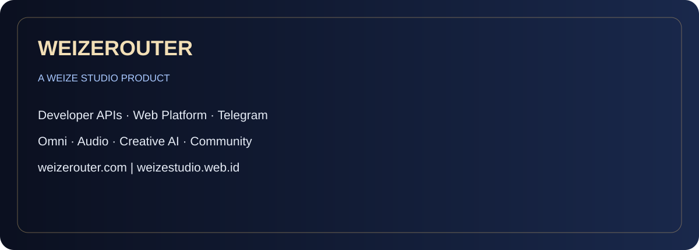
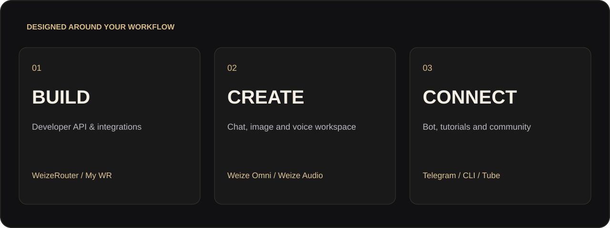
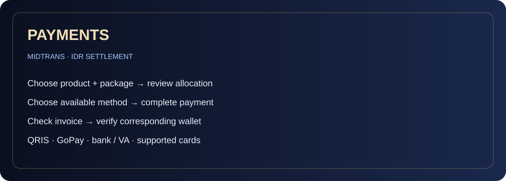

<p align="center"></p>

<p align="center">
  <a href="https://weizerouter.com/"></a>
  <a href="https://weizestudio.web.id/"></a>
  <a href="https://t.me/WeizeRouterBot"></a>
</p>

<h1 align="center">The Weize Studio Ecosystem</h1>
<p align="center"><strong>Developer infrastructure. Creative intelligence. A connected product family.</strong><br>Built independently in Medan, Indonesia — for developers, creators and businesses.</p>

<p align="center"><a href="#01--choose-your-workspace">Products</a> · <a href="#02--the-complete-ecosystem">Ecosystem</a> · <a href="#03--build-with-weizerouter">Developer API</a> · <a href="#04--accounts-wallets--payments">Payments</a> · <a href="#05--learn-integrate--explore">Guides</a> · <a href="#06--official-contacts--socials">Contacts & Socials</a></p>

---

**Weize Studio** brings cloud APIs, AI experiences, software engineering and automation under one parent brand. **WeizeRouter** is our developer gateway; **My WeizeRouter** is the web account experience; **Weize Omni** is the browser AI workspace; **Weize Audio** gives text a voice. Telegram, tutorials and community connect the ecosystem.

> **Official public documentation · refreshed 26 November 2026.** Live product pages, account permissions and checkout govern current availability and commercial terms. This is a documentation repository, not the private production codebase.

## 01 · Choose your workspace



<table>
<tr><td width="33%" valign="top"><h3>Build with APIs</h3><p>Connect applications, coding agents and compatible editors. Manage your own keys, purchases and usage on the web.</p><p><a href="https://weizerouter.com/">Open WeizeRouter →</a></p></td><td width="33%" valign="top"><h3>Create in the browser</h3><p>Use Omni for chat, image and voice workflows. Open Audio Studio for dedicated text-to-speech creation.</p><p><a href="https://weizeomni.web.id/">Open Omni →</a> · <a href="https://weizerouter.com/audio">Audio Studio →</a></p></td><td width="33%" valign="top"><h3>Start from Telegram</h3><p>Browse bot products, purchase packages, check balances and request your personal portal. Learn alongside the community.</p><p><a href="https://t.me/WeizeRouterBot">Open the bot →</a></p></td></tr>
</table>

## 02 · The complete ecosystem

### Foundation & developer tools

| Product | Experience | Official destination |
| --- | --- | --- |
| **Weize Studio** | Parent brand · cloud API · software engineering · automation | [Studio](https://weizestudio.web.id/) |
| **WeizeRouter** | AI gateway with supported OpenAI- and Anthropic-compatible interfaces | [Platform](https://weizerouter.com/) |
| **My WeizeRouter** | Web registration, purchases, API keys, wallets and usage | [Web account](https://weizerouter.com/login/) |
| **WeizeRouter Bot** | Telegram purchases, balances, keys, help and private portal access | [@WeizeRouterBot](https://t.me/WeizeRouterBot) |
| **CLI & integrations** | Public guidance for coding agents, editors and SDKs | [CLI guide](https://weizerouter.web.id/cli-guide.html) · [Integrations](docs/integrations.md) |

### Creative AI & specialist products

| Product | Experience | Entry / access |
| --- | --- | --- |
| **Weize Omni** | Google-login browser workspace for AI chat, image and voice, with its own credits | [Open Omni](https://weizeomni.web.id/) |
| **Weize Audio** | Text-to-speech Studio and API; separate Audio accounting | [Audio Studio](https://weizerouter.com/audio) |
| **Weize Image Turbo** | Credit-based image generation in Telegram | Bot command `/gambar` |
| **Video workspace & catalog** | Dedicated media surfaces with product-specific access and billing | Check current website / Omni workspace; listed models are not a generation guarantee |
| **Weize Uncensored · 18+** | Separate adult-only text service with its own balance and credentials | Bot product menu · lawful-use terms apply |

### Packages, business & community

| Service | What to know | Official destination |
| --- | --- | --- |
| **Regular personal portal** | Your bot account's private balance and usage surface | Request your unique link from the bot |
| **Weize Premium** | Premium wallet and eligible frontier-model experience | [Premium](https://weizerouter.web.id/premium) |
| **Weize Unlimited** | Fixed-price packages with their own duration and conditions | [Unlimited](https://weizerouter.web.id/unlimited) |
| **Official Resellers** | Registration, signature directory and program terms; purchase access varies | [Reseller directory](https://my.weizerouter.web.id/reseller-resmi) |
| **Partner program** | Business partnership subject to current enrollment and terms | [Partner](https://weizerouter.web.id/partner/) · admin if unavailable |
| **Referral** | Personal referral entry and account statistics | Bot menu |
| **WeizeRouter Tube** | Community-created video tutorials | [Watch tutorials](https://weizerouter.web.id/tube/) |
| **Leaderboard** | Public community ranking | [Explore](https://weizerouter.web.id/leaderboard) |
| **Public telemetry** | Reported gateway activity on the website; not an uptime SLA | [WeizeRouter](https://weizerouter.com/) |
| **Weize VPS** | Cloud VPS information; new sales depend on availability | [VPS information](https://weizerouter.web.id/vps) |

[Read the ecosystem handbook →](docs/ecosystem.md)

## 03 · Build with WeizeRouter

<table>
<tr><td width="50%" valign="top"><h3>OpenAI-compatible</h3><p>Base URL: <code>https://weizerouter.com/v1</code></p><p><code>GET /v1/models</code><br><code>POST /v1/chat/completions</code></p><p>Use your own key and an exact eligible model ID. Streaming and tools depend on the selected model.</p></td><td width="50%" valign="top"><h3>Anthropic-compatible</h3><p>Origin: <code>https://weizerouter.com</code></p><p><code>POST /v1/messages</code><br><code>POST /v1/messages/count_tokens</code></p><p>Use supported models and the live integration guide. Avoid duplicating the <code>/v1</code> path in client settings.</p></td></tr>
</table>

**Existing `.web.id` API addresses remain supported.** Use `.com` as the primary address for new integrations. Accounts and product-specific keys are not automatically interchangeable.

### Your first request

Install the OpenAI SDK, set `WEIZEROUTER_API_KEY` privately, then select an exact model ID available to your account:

```python
import os
from openai import OpenAI

client = OpenAI(
    api_key=os.environ["WEIZEROUTER_API_KEY"],
    base_url="https://weizerouter.com/v1",
)

# Discover IDs available to this key before selecting one.
for model in client.models.list().data:
    print(model.id)

response = client.chat.completions.create(
    model=os.environ["WEIZEROUTER_MODEL"],
    messages=[{"role": "user", "content": "Hello, WeizeRouter!"}],
)
print(response.choices[0].message.content)
```

<details><summary><strong>Node.js · streaming example</strong></summary>

```javascript
import OpenAI from 'openai';
const client = new OpenAI({
  apiKey: process.env.WEIZEROUTER_API_KEY,
  baseURL: 'https://weizerouter.com/v1',
});
const stream = await client.chat.completions.create({
  model: process.env.WEIZEROUTER_MODEL,
  messages: [{ role: 'user', content: 'Hello, WeizeRouter!' }],
  stream: true,
});
for await (const chunk of stream) {
  process.stdout.write(chunk.choices[0]?.delta?.content ?? '');
}
```

</details>

<details><summary><strong>cURL · discover your account's models</strong></summary>

```bash
curl --fail-with-body https://weizerouter.com/v1/models \
  -H "Authorization: Bearer $WEIZEROUTER_API_KEY"
```

Do not publish your environment variables. Use [the API guide](docs/api-usage.md) for request examples and [error guidance](docs/error-codes.md) for troubleshooting.

</details>

**Bring your preferred tools:** compatible versions of Cursor, Cline, Roo Code, Continue, OpenCode, Kilo Code, Hermes Agent and custom applications can use a supported custom-provider configuration. Client-specific capabilities and setup vary; see [integrations](docs/integrations.md).

## 04 · Accounts, wallets & payments



### Choose the right account

- **Website customer:** register / sign in, choose a package, review checkout and check the order in the same website account.
- **Bot customer:** open the bot, choose a product and package, select a payment method and check the invoice in Telegram.
- **Omni customer:** use the browser workspace and its own credit system.

**A shared brand does not mean a shared wallet.** Website and Telegram identities remain separate. Regular and Premium wallets are distinct; Audio, image, video, adult-only text and Omni follow their own accounting. A key from one product is not automatically valid for another.

### Pay with the methods offered by your invoice

**Midtrans** checkout can offer **QRIS, GoPay, eligible bank Virtual Accounts / Mandiri Bill, Visa and Mastercard**. Actual choices depend on the product, provider, invoice limits and bank authorization. Orders settle in **IDR**; displayed foreign-currency conversions are estimates.

In Telegram, choose the method first: **QRIS appears as an image in chat**, while bank/card flows use the invoice payment page. Payment status and wallet fulfillment are separate checks.

### Packages without stale promises

Purchased **Regular / Premium token balances are permanent**. **Unlimited packages have a defined duration**, and other products have their own terms. Model multipliers and permissions affect usage. Bonus credit is not cash. Prices, promotions, stock and exact allocations belong to the live package menu—not an outdated static table.

[Packages & balances →](docs/packages.md) · [Payment guide →](docs/payment-flow.md) · [FAQ →](docs/faq.md)

## 05 · Learn, integrate & explore

| Start here | Reference |
| --- | --- |
| Understand all products and account boundaries | [Ecosystem handbook](docs/ecosystem.md) |
| Build your first application | [API usage](docs/api-usage.md) |
| Select models and understand permissions | [Models](docs/models.md) |
| Connect your editor or agent | [Integrations](docs/integrations.md) · [CLI guide](https://weizerouter.web.id/cli-guide.html) |
| Resolve API errors | [Error guide](docs/error-codes.md) |
| Learn visually | [WeizeRouter Tube](https://weizerouter.web.id/tube/) · [YouTube](https://www.youtube.com/@weizerouter) |
| Review lawful-use expectations | [Fair use](docs/fair-use.md) · live product terms |
| Understand public status information | [Status & monitoring](docs/status-and-monitoring.md) |
| Suggest documentation improvements | [Contributing](CONTRIBUTING.md) |
| Report a vulnerability privately | [Security policy](SECURITY.md) |

## 06 · Official contacts & socials

### Talk to the team

| Channel | Official contact | Best for |
| --- | --- | --- |
| **Telegram admin** | [@wangweize4](https://t.me/wangweize4) | Purchases, account questions and custom requirements |
| **WhatsApp** | [+62 882-7720-0044](https://wa.me/6288277200044) | Business enquiries and support |
| **Studio email** | [support@weizestudio.web.id](mailto:support@weizestudio.web.id) | Support and private security reports |
| **Studio website** | [weizestudio.web.id](https://weizestudio.web.id/) | Parent brand, services, official contacts and policies |
| **Location** | Medan, Sumatera Utara, Indonesia | Operational base; not a public walk-in address |

### Follow the ecosystem

| Platform | Account / destination |
| --- | --- |
| **YouTube · WeizeRouter** | [@weizerouter](https://www.youtube.com/@weizerouter) |
| **YouTube · Weize Studio** | [@weizestudio](https://www.youtube.com/@weizestudio) |
| **Facebook** | [Weize Studio · official page](https://www.facebook.com/share/1EKfyKvR91/) |
| **X / Twitter** | [@WeizeRouter](https://x.com/WeizeRouter) |
| **TikTok** | [@weizerouter](https://www.tiktok.com/@weizerouter) |
| **Threads** | [@weizerouter.ai](https://www.threads.net/@weizerouter.ai) |
| **GitHub** | [github.com/weizerouter](https://github.com/weizerouter) |
| **Telegram announcements** | [@weizerouter_updates](https://t.me/weizerouter_updates) |
| **Telegram community** | [@weizerouter_indonesia](https://t.me/weizerouter_indonesia) |
| **Telegram service bot** | [@WeizeRouterBot](https://t.me/WeizeRouterBot) |

Contacts and social destinations are sourced from [Weize Studio's official website](https://weizestudio.web.id/), not guessed handles. Social platforms may require login. [Full contact directory →](docs/contacts-and-socials.md)

---

### A note on trust

Keep API keys, private portal links and payment data private. Public Issues are for documentation feedback; account and security reports belong in private support. No static badge certifies uptime. **RPM means requests per minute, not simultaneous concurrency**, and does not establish guaranteed daily capacity. Model listings do not certify live inference or media generation.

See live product terms and Studio policies for contractual, privacy and refund conditions. [MIT](LICENSE) covers this public documentation, not private production software or third-party model rights. All third-party trademarks belong to their respective owners.

<p align="center"><br><strong>A Weize Studio Product.</strong><br><a href="https://weizestudio.web.id/">Weize Studio</a> · <a href="https://weizerouter.com/">WeizeRouter</a> · <a href="https://weizeomni.web.id/">Weize Omni</a><br><sub>Independent technology. Connected experiences. Built in Medan.</sub></p>
